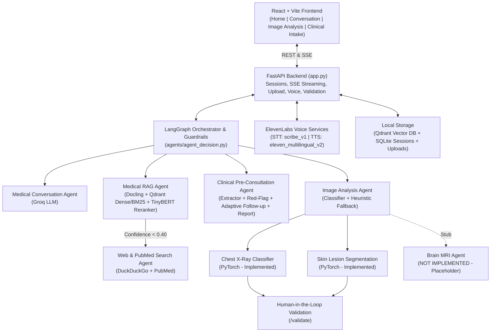

# Multi-Agent Medical AI Assistant

An agentic, multi-workspace medical information, computer-vision triage, and clinical pre-consultation system built with **Python + FastAPI**, **LangGraph**, **Qdrant**, and **React (JavaScript) + Vite**.

---

## Project Overview

**Multi-Agent Medical AI Assistant** routes user requests across specialized AI agents organized into three isolated workspaces:

1. **Medical AI Conversation** — Answers general medical questions, retrieves peer-reviewed clinical knowledge via a hybrid RAG pipeline, and falls back to live web/PubMed search when retrieval confidence is below threshold (`0.40`).
2. **Medical Image Analysis** — Accepts clinical image uploads (`PNG`, `JPG`, `JPEG`, max `5 MB`) for Chest X-ray COVID-19/Normal classification and Skin Lesion semantic segmentation, with mandatory **Human-in-the-Loop** verification. *(Brain MRI tumor analysis is currently a placeholder and is **NOT IMPLEMENTED**.)*
3. **Clinical Pre-Consultation** — Conducts an adaptive, multi-turn outpatient intake interview, screens every turn for emergency red-flag symptoms, collects patient confirmation, and generates a structured, editable, doctor-facing pre-consultation report (with PDF export).

> **Important:** This system provides medical information and doctor-facing pre-consultation intake support only. It does **not** diagnose diseases, prescribe treatments, or replace qualified healthcare professionals.

---

## Key Features

- **LLM-Driven Multi-Agent Routing** — Orchestrated via LangGraph (`agents/agent_decision.py`) using Groq (`qwen/qwen3.8-27b` default via `GROQ_MODEL`) with local guardrails and rate-limit coordination.
- **Hybrid Medical RAG Pipeline** — Docling document parsing, semantic/Markdown chunking (`512` tokens, `50` overlap), HuggingFace dense embeddings (`sentence-transformers/all-MiniLM-L6-v2`, `384`-dim) + `Qdrant/bm25` sparse vectors in local Qdrant, Cross-Encoder reranking (`cross-encoder/ms-marco-TinyBERT-L-6`), and source references.
- **Real-Time Web & PubMed Fallback** — Automatically triggers DuckDuckGo (`ddgs`) and PubMed search (`agents/web_search_processor_agent/`) when RAG confidence is insufficient or current web literature is needed.
- **Medical Computer Vision with Human Validation**:
  - **Chest X-Ray Agent** (Implemented): PyTorch binary classification (`POSITIVE` COVID-19 vs `NEGATIVE` / `NORMAL`).
  - **Skin Lesion Agent** (Implemented): PyTorch UNet-style segmentation producing an output mask plot (`/uploads/skin_lesion_output/segmentation_plot.png`).
  - **Brain Tumor MRI Agent** (**NOT IMPLEMENTED**): Currently an architectural placeholder returning a disclaimer.
- **Adaptive Clinical Pre-Consultation** — Disease-independent intake pipeline (`PatientInfoCollector`, `RedFlagDetector`, `FollowupQuestionGenerator`, `PreConsultationReportGenerator`) with emergency keyword/LLM red-flag escalation, patient review/corrections, and client-side PDF export (`pdfGenerator.js`).
- **Voice Input & Output** — Microphone Speech-to-Text (`POST /transcribe` via ElevenLabs `scribe_v1`, supporting English/Hindi/Hinglish) and assistant Read-Aloud Text-to-Speech (`POST /generate-speech` via ElevenLabs `eleven_multilingual_v2`) with Play/Pause/Resume/Stop controls.
- **Workspace & Session Isolation** — SQLite-backed session management (`storage/`) with workspace-scoped prefixes (`conv_`, `img_`, `clin_`), SSE token streaming (`/chat/stream`), and automatic input focus across workspaces.

---

## System Architecture



---

## Technology Stack

### Backend
- **Framework:** Python 3.11+, FastAPI (`0.115.11`), Uvicorn (`0.34.0`), Pydantic (`2.10.6`)
- **Agent Orchestration:** LangGraph (`0.3.9`), LangChain (`0.3.20`)
- **LLM Provider:** Groq (`langchain-groq` / `groq_llm_provider.py`, default `qwen/qwen3.8-27b`)
- **Vector Store & Embeddings:** Qdrant (`qdrant-client==1.13.3`, `langchain-qdrant==0.2.0`), HuggingFace `sentence-transformers/all-MiniLM-L6-v2` (`384`-dim), `FastEmbedSparse` (`Qdrant/bm25`), Cross-Encoder `cross-encoder/ms-marco-TinyBERT-L-6`
- **Document Parsing & Web Search:** Docling (`2.31.0`), `ddgs` (`9.16.1`), PubMed search
- **Computer Vision:** PyTorch (`2.7.0`), TorchVision (`0.22.0`), OpenCV (`4.11.0.86`), Pillow (`11.1.0`), Matplotlib (`3.10.1`)
- **Voice (STT/TTS):** ElevenLabs (`elevenlabs==1.54.0`), `pydub` (`0.25.1`)
- **Storage:** Local Qdrant (`./data/qdrant_db`), `LocalFileStore` (`./data/docs_db`), SQLite session store (`./storage/`)

### Frontend
- **Framework:** React (`18.3.1`, JavaScript — **not** TypeScript), Vite (`5.4.11`), React Router DOM (`7.18.6`)
- **Markdown & Sanitization:** `marked` (`18.2.1`), `dompurify` (`3.5.0`)

---

## Project Structure

```text
Multi-Agent-Medical-Assistant/
├── app.py                              # FastAPI entrypoint, routes, SSE streaming, uploads, voice
├── config.py                           # Centralized configuration (LLM, RAG, CV, Clinical, Speech, API)
├── groq_llm_provider.py                # Groq-only LLM wrapper with retries, rate limiting & key redaction
├── groq_rate_limiter.py                # In-process Groq rate coordination
├── provider_config_adapter.py          # Provider factory adapter
├── ingest_rag_data.py                  # RAG document ingestion entrypoint
├── requirements.txt                    # Pinned Python backend dependencies
├── .env.example                        # Environment variable template
├── agents/
│   ├── agent_decision.py               # LangGraph multi-agent router & workflow
│   ├── provider_error_handler.py       # Standardized provider error handling
│   ├── guardrails/                     # Local input/output safety guardrails
│   ├── rag_agent/                      # Docling parser, chunker, Qdrant hybrid store, reranker, generator
│   ├── web_search_processor_agent/     # DuckDuckGo & PubMed search + synthesis
│   ├── image_analysis_agent/           # Image classifier + Chest X-Ray & Skin Lesion models (Brain MRI stub)
│   └── clinical_pre_consultation_agent/# Collector, Red-Flag detector, Follow-up generator, Report generator
├── frontend/
│   ├── package.json                    # React + Vite scripts & dependencies
│   ├── package-lock.json               # Locked npm dependency tree
│   ├── vite.config.js                  # Dev server & API proxy configuration
│   └── src/
│       ├── App.jsx                     # Router & workspace layout
│       ├── context/                    # ConversationContext, ClinicalContext, ImageAnalysisContext
│       ├── hooks/                      # useWorkspaceAutoFocus, useVoiceRecorder
│       ├── pages/                      # HomePage, MedicalConversationPage, ImageAnalysisPage, ClinicalPage
│       ├── components/                 # Chat, ImageAnalysis, Clinical, Sidebar, Common UI components
│       └── utils/                      # focusUtils, speech, streaming, markdown, pdfGenerator
├── sample_images/                      # Sample Chest X-ray and Skin Lesion test images
├── storage/                            # SQLite session database & persistence helpers
├── tests/                              # Pytest regression suites (voice/TTS/STT & clinical scenarios)
└── data/                               # Local Qdrant vector DB, docstore, parsed docs, clinical DB
```

---

## Installation and Setup (Windows PowerShell)

### Prerequisites
- **Python 3.11** (or compatible Python 3.x matching `requirements.txt`)
- **Node.js 18+ and npm**
- **Git**

### 1. Clone the Repository
```powershell
git clone https://github.com/Saafin000/Multi-Agent-Medical-AI-Assistant.git
cd Multi-Agent-Medical-AI-Assistant
```

### 2. Create and Activate Python Virtual Environment
```powershell
python -m venv venv
.\venv\Scripts\Activate.ps1
```

### 3. Install Backend Dependencies
```powershell
pip install -r requirements.txt
```

### 4. Install Frontend Dependencies
Uses the existing `frontend/package-lock.json`:
```powershell
cd frontend
npm ci
cd ..
```
*(You can also use `npm install` if needed.)*

---

## Environment Configuration

Create a `.env` file in the project root from `.env.example`:
```powershell
Copy-Item .env.example .env
```

Edit `.env` and configure the required variables (never commit `.env` to version control):

| Variable | Required? | Purpose |
|---|---|---|
| `GROQ_API_KEY` | **Yes** | Groq API key for routing, conversation, RAG, web synthesis, and clinical intake |
| `GROQ_MODEL` | Optional | Groq model ID (defaults to `qwen/qwen3.8-27b` in `groq_llm_provider.py`) |
| `ELEVEN_LABS_API_KEY` | Optional (for Voice) | ElevenLabs secret key (`sk_...` prefix, **not** the 64-char API Key ID) for `/transcribe` and `/generate-speech` |
| `HUGGINGFACE_TOKEN` | Optional | HuggingFace token if needed for model downloads |
| `QDRANT_URL` / `QDRANT_API_KEY` | Optional | Remote Qdrant URL/key (default `RAGConfig.use_local = True` uses `./data/qdrant_db`) |
| `deployment_name`, `model_name`, `azure_endpoint`, `openai_api_key`, `openai_api_version` | Optional | Azure OpenAI Vision credentials for `ImageClassifier` / RAG image summarizer. **If not configured**, `ImageClassifier` automatically falls back to local filename/PIL heuristic classification |
| `DEBUG`, `LOG_LEVEL` | Optional | Application debug and logging verbosity |

---

## Running the Application

Start the backend and frontend in **two separate PowerShell terminals**.

### Terminal 1 — FastAPI Backend
```powershell
.\venv\Scripts\Activate.ps1
python app.py
```
- Backend URL: `http://127.0.0.1:8000` (binds `0.0.0.0:8000`)
- Health check: `http://127.0.0.1:8000/health`

### Terminal 2 — React + Vite Frontend
```powershell
cd frontend
npm run dev
```
- Frontend URL: `http://localhost:5173`

*(Note: On first startup, SentenceTransformer/CrossEncoder models load locally; ensure internet access is available if models are not yet cached.)*

---

## Available API Endpoints

Verified routes in `app.py`:

| Method | Endpoint | Purpose |
|---|---|---|
| `GET` | `/` | Root HTML response |
| `GET` | `/health` | Health check (`{"status": "healthy"}`) |
| `POST` | `/chat/stream` | SSE token streaming for `conversation` and `clinical_pre_consultation` workspaces |
| `POST` | `/chat` | Synchronous chat endpoint across `conversation` and `clinical_pre_consultation` |
| `POST` | `/upload` | Medical image upload (`PNG`, `JPG`, `JPEG`, max `5 MB`) for `image_analysis` workspace |
| `POST` | `/validate` | Human-in-the-loop validation submission for computer vision outputs |
| `POST` | `/clinical-patient-feedback` | Submit patient edits/corrections to clinical intake data & report |
| `POST` | `/clinical-confirm` | Explicit patient confirmation/verification of the clinical pre-consultation report |
| `POST` | `/transcribe` | Speech-to-Text audio transcription via ElevenLabs (`scribe_v1`) |
| `POST` | `/generate-speech` | Text-to-Speech audio generation (`audio/mpeg`) via ElevenLabs (`eleven_multilingual_v2`) |
| `GET` | `/sessions` | List workspace sessions |
| `POST` | `/sessions` | Create a new workspace-scoped session (`conv_`, `img_`, `clin_`) |
| `GET` | `/sessions/{session_id}` | Retrieve session metadata |
| `GET` | `/sessions/{session_id}/messages` | Retrieve persisted message history for a session |
| `GET` | `/sessions/{session_id}/clinical-state` | Retrieve saved clinical intake state & report |
| `GET` | `/sessions/{session_id}/artifacts` | Retrieve session artifacts |

---

## RAG Pipeline

Implemented in `agents/rag_agent/`:
1. **Document Parsing (`doc_parser.py`)** — Parses medical PDFs/documents using Docling (`docling`), extracting structured text, tables, and visual references into `./data/parsed_docs`.
2. **Chunking (`content_processor.py`)** — Splits content into `512`-token chunks with `50`-token overlap (`RAGConfig`).
3. **Hybrid Vector Storage (`vectorstore_qdrant.py`)** — Stores documents in Qdrant (`./data/qdrant_db`, collection `medical_assistance_rag_hf`) using:
   - **Dense embeddings:** `sentence-transformers/all-MiniLM-L6-v2` (`384` dimensions, Cosine distance)
   - **Sparse embeddings:** `FastEmbedSparse` (`Qdrant/bm25`)
   - **Document store:** `LocalFileStore` (`./data/docs_db`)
4. **Query Expansion & Reranking (`query_expander.py`, `reranker.py`)** — Retrieves `top_k=5` candidates and reranks to `reranker_top_k=3` using `cross-encoder/ms-marco-TinyBERT-L-6`.
5. **Confidence Routing & Citations (`response_generator.py`)** — Generates grounded responses with source references (`include_sources=True`). If retrieval confidence falls below `min_retrieval_confidence` (`0.40`), the router automatically falls back to `WEB_SEARCH_AGENT` (DuckDuckGo + PubMed).

---

## Image Analysis Module

Implemented in `agents/image_analysis_agent/`:
- **Image Type Routing (`image_classifier.py`)**: Uses Azure OpenAI Vision if `deployment_name` and Azure credentials are configured; otherwise uses local filename/PIL heuristic classification (`_heuristic_classify`).
- **Chest X-Ray Agent (`chest_xray_agent/`) — Implemented**: PyTorch model (`covid_chest_xray_model.pth`) classifying frontal chest radiographs as **POSITIVE** or **NEGATIVE (NORMAL)** for COVID-19.
- **Skin Lesion Agent (`skin_lesion_agent/`) — Implemented**: PyTorch segmentation model (`checkpointN25_.pth.tar`) generating a segmented output plot saved to `./uploads/skin_lesion_output/segmentation_plot.png`.
- **Brain Tumor MRI Agent (`brain_tumor_agent/`) — NOT IMPLEMENTED**: Commented out in `agents/image_analysis_agent/__init__.py` and handled as an architectural placeholder returning a disclaimer.
- **Human-in-the-Loop (`ValidationConfig`)**: All vision agents require explicit clinician/user review via `POST /validate` (`Yes, Agree with Result` / `No, Disagree / Flag`).

---

## Clinical Pre-Consultation Module

Implemented in `agents/clinical_pre_consultation_agent/`:
1. **Patient Info Collector (`patient_info_collector.py`)** — Incrementally extracts chief complaint, symptom-specific timelines, severity, pertinent negatives, medications, allergies, and medical history.
2. **Red-Flag Detector (`red_flag_detector.py`)** — Evaluates every turn for emergency warning signs (e.g., `"chest pain"`, `"difficulty breathing"`, `"severe bleeding"`, `"loss of consciousness"`), prioritizing immediate emergency escalation.
3. **Adaptive Follow-Up Generator (`followup_question_generator.py`)** — Asks targeted, complaint-specific follow-up questions (up to `max_followup_questions = 8`) without relying on rigid disease templates, followed by a mandatory final confirmation prompt.
4. **Report Generator (`report_generator.py`) & UI Review** — Produces a structured, doctor-facing pre-consultation summary (`ClinicalReportViewer`) supporting patient edits (`/clinical-patient-feedback`), explicit verification (`/clinical-confirm`), and PDF export (`frontend/src/utils/pdfGenerator.js`).

---

## Voice Input and Output

- **Speech-to-Text (`POST /transcribe`)** — Frontend `useVoiceRecorder.js` captures microphone audio via `MediaRecorder` and sends it to `/transcribe`, which calls ElevenLabs `scribe_v1` with automatic language detection (tested for English, Hindi, and Hinglish). Transcripts are inserted into the input field without auto-submitting.
- **Text-to-Speech (`POST /generate-speech`)** — Assistant messages include a **Read Aloud** control calling `/generate-speech` (ElevenLabs `eleven_multilingual_v2`, voice `EXAVITQu4vr4xnSDxMaL`), with **Pause**, **Resume**, and **Stop** playback controls.
- **Note:** Voice endpoints require a valid `ELEVEN_LABS_API_KEY` (`sk_...` secret key) and active internet/DNS access to `api.elevenlabs.io`.

---

## Testing and Verification

Verified against the current codebase:
- **Automated Pytest Regression Suites:**
  ```powershell
  .\venv\Scripts\python.exe -m pytest tests\test_voice_stt_tts_fixes.py tests\test_elevenlabs_tts.py tests\test_final_acceptance_scenarios.py tests\test_browser_fever_scenario_regression.py -v
  ```
  - **Result:** `30 passed` (`8` STT/TTS contract & multilingual tests, `10` ElevenLabs TTS tests with mocked upstream, `7` clinical acceptance scenarios, `5` clinical fever regression tests).
- **Frontend Production Build:** `npm run build` (`vite build`) transformed `72` modules cleanly.
- **Live Server & Browser Verification:** Verified `/health`, `/chat/stream` SSE streaming, `/upload` (Chest X-Ray & Skin Lesion), `/chat` clinical intake & red-flag escalation, API input validation (`400`/`413`), session isolation, auto-focus across all three workspaces, and zero console/API errors in an isolated Chrome instance. Live ElevenLabs TTS/STT authentication passed when `api.elevenlabs.io` was reachable; microphone recording with real speech requires manual verification with a live microphone and active DNS to `api.elevenlabs.io`.

---

## Current Limitations

- **Brain MRI Analysis is NOT IMPLEMENTED:** Currently an architectural stub/placeholder only.
- **Models Are Not Clinically Validated:** The Chest X-ray classifier, Skin Lesion segmentation model, and LLM prompts are for academic/research demonstration only and have not undergone clinical trials or regulatory clearance.
- **External API & Network Dependency:** LLM reasoning (Groq), web/PubMed fallback, and voice synthesis/transcription (ElevenLabs) require active internet connectivity and valid API keys.
- **Azure Vision Credentials Optional:** If `deployment_name` and Azure OpenAI variables are not configured in `.env`, `ImageClassifier` uses local filename/PIL heuristics rather than a multimodal vision LLM.

---

## Safety Disclaimer

> **Academic & Research Use Only:** This project is an academic and research demonstration. It does **not** provide medical diagnoses, prescribe medications, or establish a physician-patient relationship, and it is **not** a substitute for qualified medical professionals or emergency care. In a medical emergency, contact local emergency services immediately.

---

## Author

**Saafin Hasan**  
GitHub: https://github.com/Saafin000
